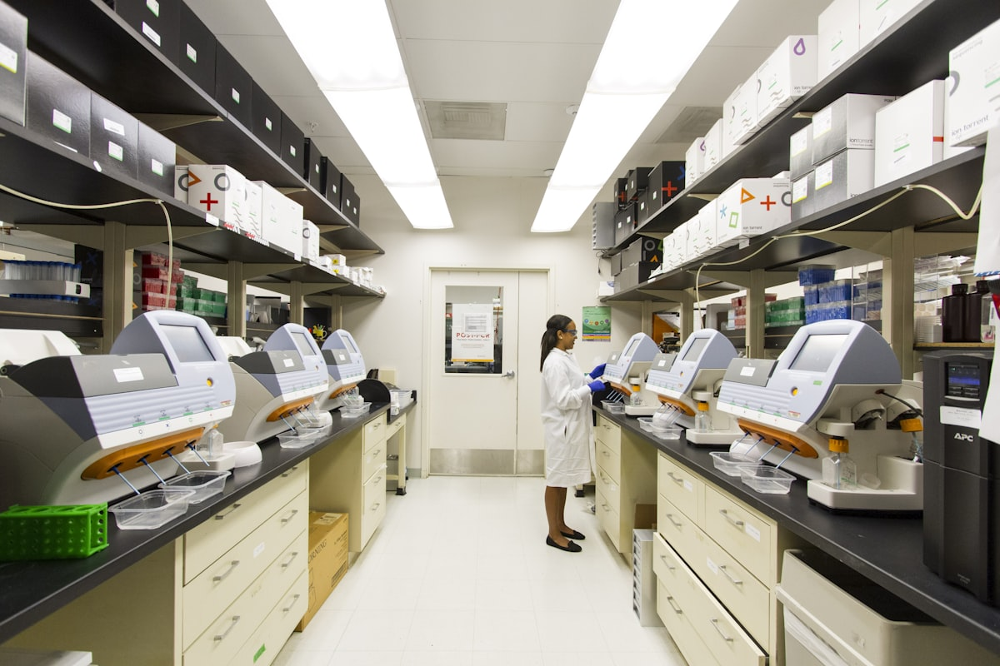

# 🩺 DermAI Agent — AI-Powered Dermatological Diagnosis System


> An AI-powered full-stack web application for dermatological skin disease diagnosis using Multimodal AI, Medical LLM, and Explainable AI visualizations.

---

## 📸 Screenshots

| Landing Page | User Dashboard | Diagnosis Results |
|---|---|---|
|  | User Portal | AI Analysis Panel |

---

## 🚀 Features

### 🤖 AI & ML
- **Multimodal AI Pipeline** — combines skin lesion image + patient metadata (age, gender, symptoms) for accurate prediction
- **Medical LLM Integration** — generates detailed medical explanations, treatment plans, and precautions per diagnosis
- **Grad-CAM Heatmap Visualization** — explainable AI showing which regions of the image influenced the prediction
- **5 Skin Conditions Detected** — Melanoma, Nevus, Basal Cell Carcinoma, Psoriasis, Eczema
- **Confidence Scoring** — probability distribution bar chart for all conditions

### 👤 User Dashboard
- New Diagnosis with image upload (drag & drop)
- AI result panel with prediction, explanation, treatment plan, risk factors
- Patient management (add, search, view)
- Diagnosis history with filters
- Report generation with live preview and download
- Profile management with picture upload
- Settings panel (5 categories)

### 🛡️ Admin Dashboard
- Overview with real-time stats and charts
- User management (add, delete)
- Patient and diagnosis management
- System logs with export
- Model management
- System settings (7 categories)
- Backup management

### 🔒 Security (OWASP ZAP Verified — 15/16 Pass)
- CSRF token protection on all forms
- Rate limiting (10 attempts / 60 seconds per IP)
- Bcrypt password hashing
- Magic-byte file upload validation
- 7 HTTP security headers (CSP, X-Frame-Options, etc.)
- Session fixation prevention
- Role-based access control (RBAC)
- SQL injection prevention (parameterized queries)
- Audit logging with IP tracking

---

## 🛠️ Tech Stack

| Layer | Technology |
|---|---|
| Backend | Python, Flask 3.0 |
| Database | SQLite |
| Frontend | HTML5, CSS3, Vanilla JavaScript |
| Charts | Chart.js |
| AI/ML | Multimodal AI, Medical LLM |
| Security | Werkzeug, CSRF, Rate Limiting |
| Auth | Session-based, bcrypt |

---

## 📁 Project Structure

```
dermai-agent/
├── app.py                  # Main Flask application
├── dermai.db               # SQLite database (auto-created)
├── requirements.txt        # Python dependencies
├── templates/
│   ├── index.html          # Landing page
│   ├── login.html          # Login page
│   ├── signup.html         # Signup page
│   ├── user.html           # User dashboard
│   └── admin.html          # Admin dashboard
├── static/
│   ├── css/
│   │   ├── styles.css      # Global styles
│   │   ├── user.css        # User dashboard styles
│   │   └── admin.css       # Admin dashboard styles
│   ├── js/
│   │   ├── main.js         # User dashboard logic
│   │   ├── admin.js        # Admin dashboard logic
│   │   └── db.js           # API helper
│   ├── img/                # Images
│   └── uploads/            # Uploaded diagnosis images
└── README.md
```

---

## ⚙️ Installation & Setup

### Prerequisites
- Python 3.10+
- pip

### 1. Clone the repository
```bash
git clone https://github.com/yourusername/dermai-agent.git
cd dermai-agent
```

### 2. Create virtual environment
```bash
python -m venv venv

# Windows
venv\Scripts\activate

# Mac/Linux
source venv/bin/activate
```

### 3. Install dependencies
```bash
pip install -r requirements.txt
```

### 4. Run the application
```bash
python app.py
```

### 5. Open in browser
```
http://127.0.0.1:5000
```

---

## 🔑 Default Credentials

| Role | Email | Password |
|---|---|---|
| Admin | admin@gmail.com | admin123 |
| User | Register via /signup | — |

> ⚠️ Change the admin password after first login.

---

## 🌐 API Endpoints

| Method | Endpoint | Description | Auth |
|---|---|---|---|
| POST | `/login` | User/Admin login | Public |
| POST | `/signup` | Register new user | Public |
| GET | `/logout` | Logout | Logged in |
| GET | `/user` | User dashboard | User |
| GET | `/admin` | Admin dashboard | Admin |
| POST | `/api/diagnose` | Run AI diagnosis | User |
| GET | `/api/patients` | Get patients | User |
| GET | `/api/diagnoses` | Get diagnoses | User |
| POST | `/api/patients/add` | Add patient | User |
| POST | `/api/profile` | Update profile | User |
| POST | `/api/change-password` | Change password | User |
| GET | `/api/users` | Get all users | Admin |
| POST | `/api/admin/add-user` | Add user | Admin |
| POST | `/api/users/delete/<id>` | Delete user | Admin |
| GET | `/api/logs` | System logs | Admin |
| GET | `/api/stats` | Statistics | User/Admin |

---

## 🔐 Security Architecture

```
┌─────────────────────────────────────────────┐
│           SECURITY LAYERS                   │
├─────────────────────────────────────────────┤
│  1. Rate Limiting    → 10 req / 60s per IP  │
│  2. CSRF Tokens      → All POST forms       │
│  3. Bcrypt Hashing   → All passwords        │
│  4. Session Security → HttpOnly, SameSite   │
│  5. Upload Validation→ Magic bytes + size   │
│  6. Security Headers → CSP, X-Frame, etc.   │
│  7. RBAC             → User / Admin roles   │
│  8. SQL Parameterized→ No injection         │
│  9. Audit Logs       → All actions logged   │
│ 10. Session Fixation → session.clear()      │
└─────────────────────────────────────────────┘
```

---

## 📊 Skin Conditions Supported

| Condition | Risk Level | Description |
|---|---|---|
| Melanoma | 🔴 High | Most dangerous form of skin cancer |
| Basal Cell Carcinoma | 🟠 Medium | Most common skin cancer, treatable |
| Nevus | 🟢 Low | Benign mole, monitoring recommended |
| Psoriasis | 🟡 Medium | Chronic inflammatory condition |
| Eczema | 🟢 Low | Atopic dermatitis, manageable |

---

## 📦 Requirements

```
Flask==3.0.3
Werkzeug==3.0.3
```

---

## ⚠️ Disclaimer

> This application is an AI-assisted decision-support tool and **not a substitute for professional medical advice**. Always consult a qualified dermatologist for diagnosis and treatment.

---

## 📄 License

This project is licensed under the MIT License.

---

## 👨‍💻 Author

**Abhishek** — DermAI Agent Project

---

*Built with ❤️ using Flask, Multimodal AI, and Medical LLM*
